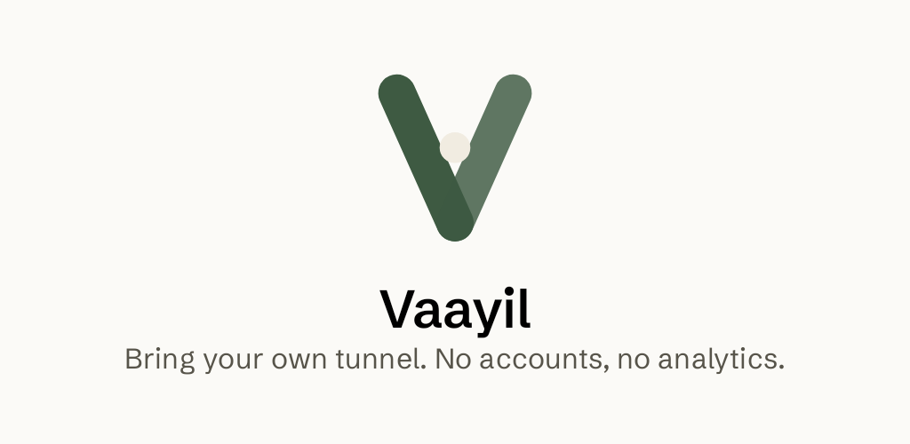
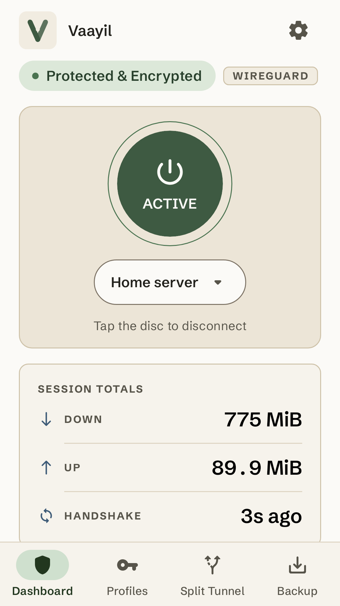
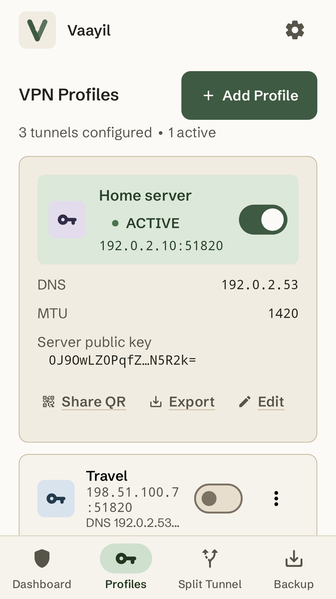
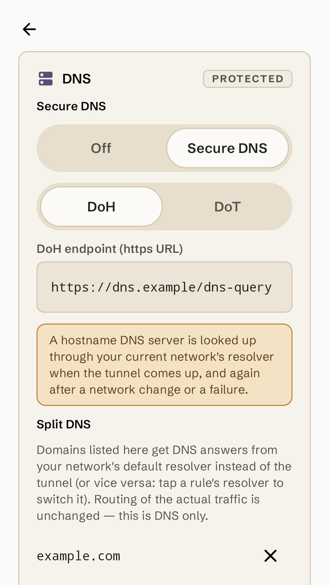
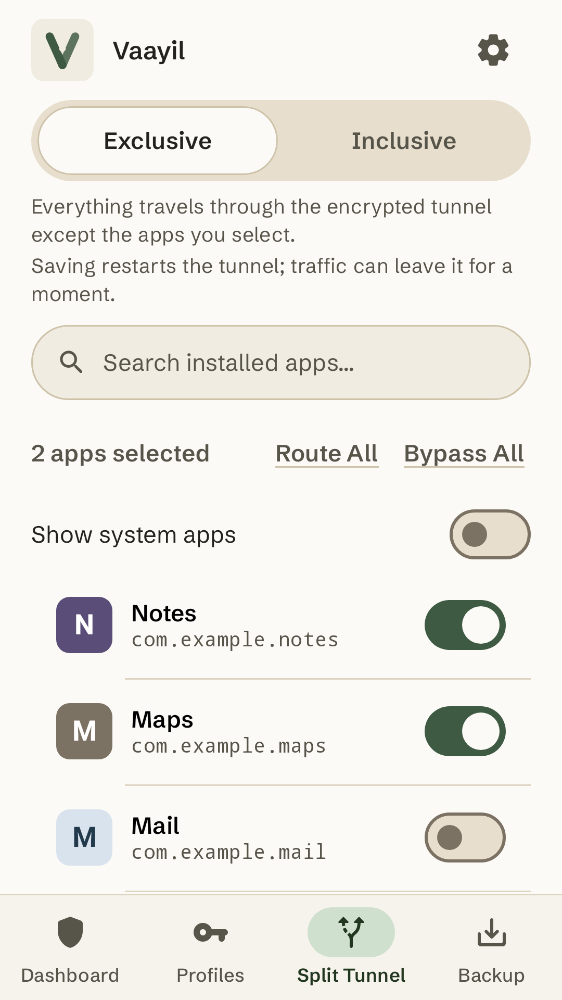
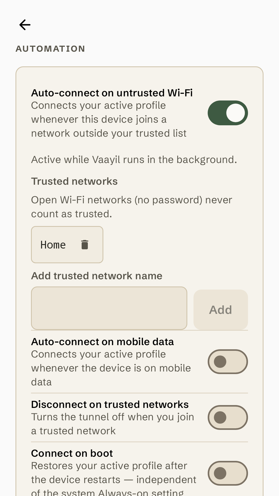
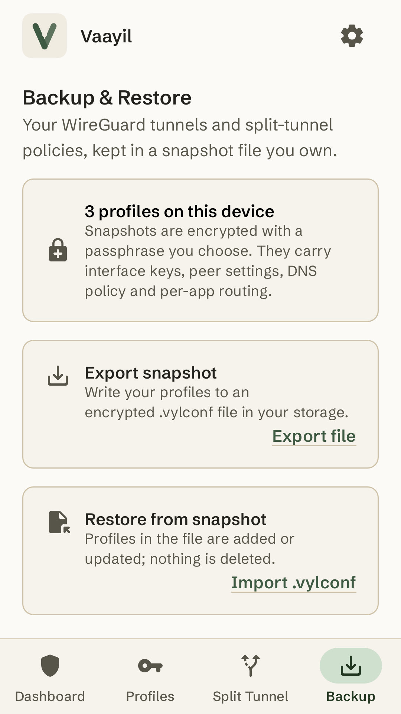

<h1 align="center">
  
</h1>

<p align="center">
  <strong>A calm, private WireGuard® client for Android, for the tunnels you already have.</strong>
</p>

<p align="center">
  <a href="LICENSE"></a>
  
  
  
</p>

<p align="center">
  <a href="#features">Features</a> ·
  <a href="#privacy">Privacy</a> ·
  <a href="#permissions">Permissions</a> ·
  <a href="#install">Install</a> ·
  <a href="#building-from-source">Build from source</a> ·
  <a href="#contributing">Contributing</a>
</p>

**Vaayil** (வாயில், Tamil for "gateway") connects your Android phone or tablet to the
WireGuard tunnels you already have: a server you run yourself, or a configuration from a
provider you trust. It sells no
bandwidth, runs no servers and has no accounts. Every feature is free, with no trial
limit, no in-app purchases and no ads, and Vaayil is free software under
[GPL-3.0-or-later](#licence).

<div align="center">
  <table>
    <tr>
      <td align="center"><br><sub><b>One-tap dashboard</b></sub></td>
      <td align="center"><br><sub><b>Your profiles</b></sub></td>
      <td align="center"><br><sub><b>Secure DNS</b></sub></td>
    </tr>
    <tr>
      <td align="center"><br><sub><b>Split tunneling</b></sub></td>
      <td align="center"><br><sub><b>Automation</b></sub></td>
      <td align="center"><br><sub><b>Encrypted backup</b></sub></td>
    </tr>
  </table>
</div>

## Features

### Bring your own tunnel

- **Import a profile however it reaches you:** open a WireGuard `.conf` file, paste a
  configuration, scan a QR code, or type the details in. Vaayil can generate a key pair
  for a new profile.
- **Share or export:** show a profile as a QR code, in a window that blocks screenshots,
  or export it as a `.conf` file.
- **Switch safely:** if a switch to another profile fails, the tunnel you were on stays
  up, and Vaayil tells you.

### Connect with one tap

- **One disc:** the dashboard's connect disc starts and stops the profile you pick, and
  every profile has its own connect switch on the Profiles tab.
- **"Connected" means your server answered:** Vaayil shows a tunnel as connected only
  once your server has completed a handshake with it. Until then it says it's
  connecting, and it tells you when a handshake is slow to arrive.
- **Honest numbers:** session totals for data received and sent, and the time since the
  last handshake. No invented speeds, latency figures or "fastest" badges.
- **Always in reach:** a notification shows the tunnel's state and carries a Disconnect
  button.

### Split tunneling

- **Exclusive or Inclusive:** send every app through the tunnel except the ones you
  choose, or only the ones you choose.
- **One set of rules** for whichever profile is connected. A change applies as soon as
  you save it: a running tunnel restarts to pick it up.

### Encrypted DNS and split DNS

- **DNS over HTTPS or DNS over TLS,** set per profile, with one-tap presets for
  well-known DNS-over-HTTPS resolvers. Encrypted DNS travels inside the tunnel, through
  Vaayil's own resolver.
- **Split DNS:** have chosen domains answered by your current network's resolver instead
  of the tunnel's, which helps with names on your local network. It changes only which
  resolver answers; connections are routed as before.
- **A clear warning** when a profile would send its DNS lookups outside the tunnel.

### Automation

- **Wi-Fi guard:** connect automatically when you join a Wi-Fi network that isn't on your
  trusted list, and, if you like, disconnect when you reach a trusted one. Open networks
  never count as trusted, even when their name is on the list.
- **Mobile data and start-up:** connect whenever the device is on mobile data, or when
  it starts up.
- **Tasker and other automation apps (optional):** start and stop tunnels with explicit
  intents, protected by a per-install token. See [docs/automation.md](docs/automation.md).

### Kill switch, explained

- Vaayil works with Android's **Always-on VPN** and **Block connections without VPN**,
  and walks you through turning them on. With both on, Android blocks apps' connections
  whenever the tunnel is down, and apps you exclude in Split Tunnel can't connect at all.
- One limit is Android's own: it doesn't block DNS lookups. While the tunnel is down, and
  for apps you exclude, the network you're on can still see the names apps look up.
  Vaayil's guide says so too.

### Backup and restore

- Export every profile into one `.vylconf` file, encrypted with a passphrase you choose,
  and restore it on your next phone.

## Privacy

- **No accounts, no analytics, no crash reporting, no ads.**
- **Only the connections you set up:** Vaayil talks only to your WireGuard server and the
  DNS servers you configure, plus your current network's resolver for hostname lookups
  and split-DNS domains. There are no update checks and no telemetry.
- **Keys encrypted at rest:** private and preshared keys are encrypted with a key held in
  the Android Keystore, when the device's Keystore is available. If it isn't, the
  Profiles screen says so.
- **No silent copies:** Android cloud backup and device-to-device transfer are off for
  Vaayil. To move to a new phone, export an encrypted backup yourself.
- **Wi-Fi names stay on the device:** the Wi-Fi guard reads the current network's name and
  security type, keeps no history and never sends either anywhere.
- **Exports are secrets:** an exported `.conf` file or QR code holds the profile's private
  key unencrypted, so treat it like a password.

The [privacy policy](docs/privacy-policy.md) has the details.

## Permissions

| Permission | What Vaayil uses it for |
| --- | --- |
| **VPN** | Running your tunnel. Android asks before the first connection. |
| **Notifications** | The tunnel's status and its Disconnect button. Asked once on Android 13 and newer, during setup or before your first connection. |
| **Camera** | Scanning a profile's QR code, asked when you first scan. Frames are decoded on the device and never stored. |
| **Location, "Allow all the time"** | Only the Wi-Fi guard: Android reveals the Wi-Fi network's name only to apps with location access, and the guard runs in the background. Asked only when you turn the guard on. Vaayil reads no GPS coordinates. |
| **Network and Wi-Fi state** | Following network changes, and checking whether the current Wi-Fi network is secured. |
| **Run at startup** | Connect on boot, and restarting the Wi-Fi guard after a reboot, when you've turned them on. |
| **Foreground service** | Keeping the tunnel and the Wi-Fi guard running while you use other apps. |
| **Internet** | Reaching your WireGuard server and your DNS servers. |

Vaayil needs no storage permission: files you import or export go through Android's
file picker. The Split Tunnel tab lists your apps on the device only and never sends the
list anywhere.

## Under the hood

- **WireGuard, built from source.** Tunnels run on wireguard-go through
  wireguard-android's tunnel module, vendored at tag 1.0.20260102. Its native library is
  compiled from source by the Gradle build, with the Go toolchain checked against a
  pinned SHA-256.
- **A resolver with no open port.** For profiles with Secure DNS or split DNS, a small
  filter in the tunnel's packet path hands DNS queries for Vaayil's resolver address
  straight to the app over a private socket pair; nothing listens on port 53. If the
  resolver can't recover from a failure, lookups fail closed and the dashboard asks you
  to reconnect.
- **One way in.** Every connect and disconnect, whether from the dashboard, the
  notification, automation or Tasker, goes through one service, and every screen reads
  the same tunnel status.
- **A platform-free core.** The domain model, config parser, tunnel API and DNS resolver
  are plain Kotlin with no Android imports, tested on the JVM.
- **Tested on several levels:** JVM unit tests, Robolectric tests for the Android
  modules, screenshot tests that compare the main screens against committed images
  (Roborazzi), and `go vet` plus `go test -race` for the native DNS filter.
- **Built with** Kotlin, Jetpack Compose and Material 3, Room, DataStore, OkHttp, minidns
  and ZXing.

## Install

Vaayil 1.0.0 is on its way:

- **GitHub Releases:** signed APKs with every release;
  [Obtainium](https://github.com/ImranR98/Obtainium) can follow this repository for
  updates. Coming with v1.0.0.
- **F-Droid:** coming soon.
- **Google Play:** planned.

Until then, [build it from source](#building-from-source). Vaayil needs Android 8.0
(API 26) or newer, and a WireGuard configuration to connect to.

## Building from source

Prerequisites:

- JDK 17
- Android SDK: compileSdk/targetSdk 36, minSdk 26, Android Gradle Plugin 8.10.x
- NDK 27.0.12077973 and CMake 3.22.1 — the vendored WireGuard tunnel module builds its
  native library from source, and needs `make` and a host C compiler (`cc`) on `PATH`
- The first native build downloads Go 1.24.3 into the Gradle user home, checked against
  a pinned SHA-256, and can take several minutes

If your JDK or Android SDK lives outside the system paths:

```bash
export JAVA_HOME=/path/to/jdk-17
export ANDROID_HOME=/path/to/android-sdk
export PATH=$JAVA_HOME/bin:$PATH
```

Build a debug APK:

```bash
git clone https://github.com/ATGPlatforms/vaayil.git
cd vaayil
./gradlew :app:assembleDebug
```

The APK lands in `app/build/outputs/apk/debug/`. A release build
(`./gradlew :app:assembleRelease`) is unsigned unless you supply your own key in
`keystore.properties`; `keystore.properties.example` shows the format.

Full gate (what CI runs):

```bash
./gradlew build
./gradlew :app:verifyRoborazziDebug
```

## Project layout

| Module | Role |
|---|---|
| `:core:model` | Pure-Kotlin domain: profiles, DNS policy, auto-connect rules, validation |
| `:core:config` | wg-quick parse/serialize |
| `:core:tunnel-api` | Tunnel engine seam + status/stats/error types |
| `:core:dns` | In-tunnel DNS resolver: split-DNS matcher, plain/DoT/DoH upstreams, cache |
| `:core:data` | Room + DataStore persistence, backup codec |
| `:core:tunnel-wg` | WireGuard engine, VPN service seam, resolver controller |
| `:core:automation` | Wi-Fi watcher, auto-connect foreground service, boot and Tasker receivers |
| `:core:ui` | Shared Vellum primitives |
| `:feature:*` | Compose UI: profiles, tunnel, settings |
| `:app` | Single APK entry point |
| `:third-party:wireguard-tunnel` | Vendored WireGuard tunnel module (built from source) |

The domain core stays platform-free, all tunnel control routes through one service, and
[AGENTS.md](AGENTS.md) records the architecture invariants.

## Contributing

- **Bugs and feature requests:** [open an issue](https://github.com/ATGPlatforms/vaayil/issues).
- **Changes:** read [CONTRIBUTING.md](CONTRIBUTING.md) — contributions are accepted
  under the Developer Certificate of Origin, with a `git commit -s` sign-off on every
  commit.
- **Security:** report privately as described in [SECURITY.md](SECURITY.md).
- **Community:** participation is governed by [CODE_OF_CONDUCT.md](CODE_OF_CONDUCT.md).

## How Vaayil is built

> **How Vaayil is built.** Vaayil's code is written and reviewed by AI coding agents working under the maintainer's direction. The maintainer decides what gets built, sets the design and the rules the agents follow (see `AGENTS.md`), reviews the results, and tests releases on real devices. Commits made this way carry the maintainer's sign-off as the person responsible, and an AI co-author line.

## Acknowledgements

Vaayil stands on [WireGuard](https://www.wireguard.com/) and wireguard-android's tunnel
module, wireguard-go, minidns, OkHttp, ZXing, AboutLibraries, the Android Jetpack
libraries and the Schibsted Grotesk typeface. The app's open-source licences screen
lists every bundled component and its licence.

## Licence

Vaayil is free software: **GPL-3.0-or-later**. The full text is in [LICENSE](LICENSE).
The artwork — the launcher icon, the logo and the store images — is covered by the same
licence. The vendored `third-party/wireguard-tunnel` module keeps the upstream
Apache-2.0 licence for upstream code, with Vaayil's own files there under
GPL-3.0-or-later.

The licence grants no rights to the name "Vaayil" or its logo as marks (GPL-3.0
section 7(e)): you may fork Vaayil, but a modified version you distribute must use a
different name and icon, so nobody mistakes it for Vaayil. See
[TRADEMARK.md](TRADEMARK.md).

Copyright © 2026 Ajay R. Bundled dependencies are Apache-2.0 / MIT / BSD-class;
with two further notices: the Schibsted Grotesk font ships under the SIL Open
Font License, Version 1.1, and OkHttp's bundled Public Suffix List data under
MPL-2.0; the app's open-source licences screen lists them.

"WireGuard" is a registered trademark of Jason A. Donenfeld; Vaayil is a WireGuard client
and is not affiliated with the WireGuard project.

## Documentation

- [AGENTS.md](AGENTS.md) — engineering rules and architecture invariants
- [PRODUCT.md](PRODUCT.md) — product voice and principles
- [DESIGN.md](DESIGN.md) — the Vellum design system
- [docs/automation.md](docs/automation.md) — the automation intent contract
- [docs/privacy-policy.md](docs/privacy-policy.md) — privacy policy
- [docs/fonts-schibsted-grotesk.md](docs/fonts-schibsted-grotesk.md) — bundled font and
  its licence
